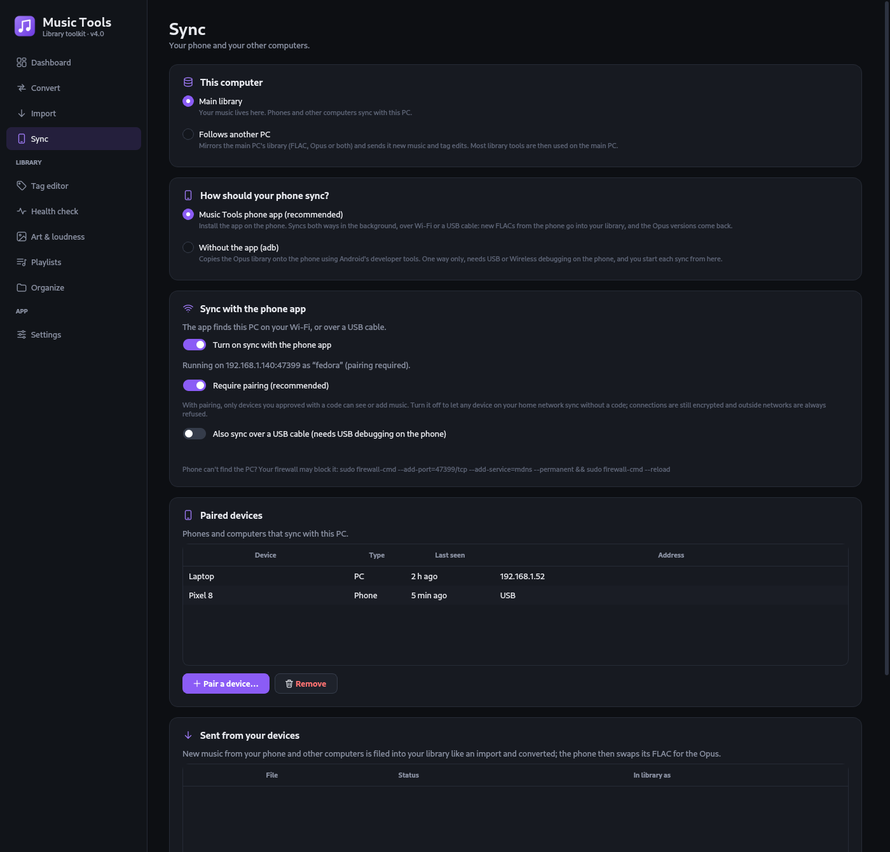
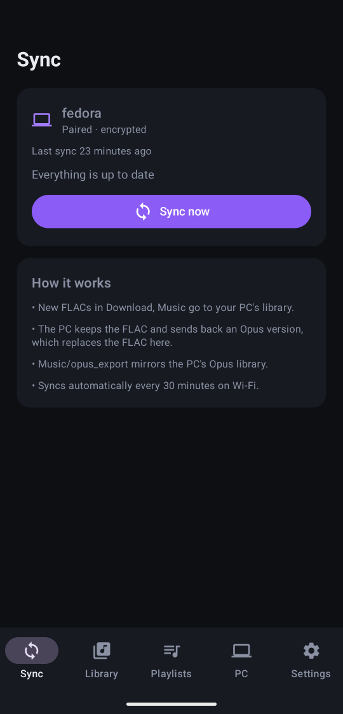
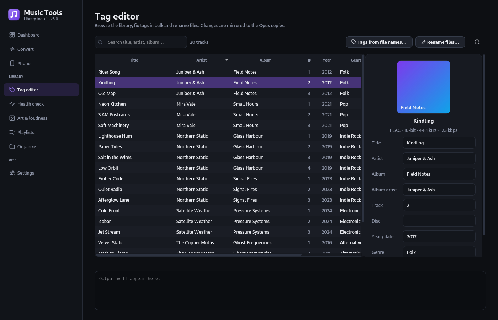
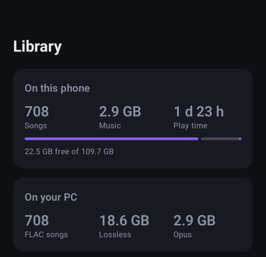
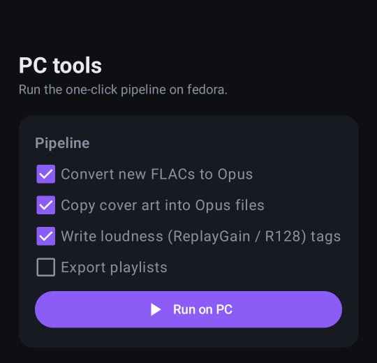

# Music Tools

Keep a lossless FLAC library on your PC and an Opus copy of it on your Android phone and your other computers,
in sync both ways.

- **Desktop app** (Windows, Linux): convert, tag, check and organize the FLAC library, and serve it to your phone
  and your other computers.
- **Phone app** (Android): mirrors the library as Opus over Wi-Fi or a USB cable, sends FLACs you got on the go
  back to the PC, and lets you manage playlists, choose what to sync and run the PC's tools from the phone.

The main PC holds the master copy. A FLAC that lands on your phone goes to the PC, gets filed into the library and
converted, and comes back as Opus; the phone's FLAC is removed once the Opus has arrived. A laptop or second
desktop can follow the main PC the same way, with its own FLAC and/or Opus copy.

<p align="center">
  
  
</p>

## Download

Get the latest build from [Releases](https://github.com/tianxibang/Music-tools/releases):

- **Windows**: unzip `MusicTools-windows-x64.zip` and run `MusicTools.exe`.
- **Linux**: `tar xzf MusicTools-linux-x64.tar.gz`, then run `MusicTools/install-linux.sh` to add it to your
  app menu (or just start `MusicTools/MusicTools`).
- **Android**: install `MusicTools-android.apk` (allow installing from your browser or files app when asked).

The desktop app needs ffmpeg and opusenc; see [External programs](#external-programs).

## Getting started

1. Open the desktop app, set your FLAC library and Opus export folders in **Settings**.
2. Go to **Sync**, choose **Music Tools phone app**, and turn on **Turn on sync with the phone app**.
3. Click **Pair a device…** and scan the QR code with the phone app (or tap the PC in its list and type the code).

That's it: the phone syncs about every 30 minutes on Wi-Fi, or whenever you tap **Sync now**.

Got a second computer? Install Music Tools there too and see [Other computers](#other-computers).

## Desktop app

<p align="center"></p>

| Page | What it does |
|---|---|
| Dashboard | Library stats, phone status, watch folder, **one-click pipeline** (convert → cover art → loudness → playlists → sync) |
| Convert | FLAC → Opus in parallel, skips finished files, finds orphaned Opus files |
| Import | Merge music from another drive or folder: adds new songs, replaces worse copies with better ones, skips what you have |
| Sync | Whether this PC is the **main library** or **follows another PC**, and how the phone syncs: with the **phone app** (two-way, background, Wi-Fi or USB), or **without the app** (one-way copy over adb) |
| Tag editor | Searchable table, bulk-edit tags and covers, rename files from tags, tags from file names. Edits carry over to the Opus copies |
| Lyrics | Write lyrics, find them online (LRCLIB, also for many songs at once) and sync them line by line or word by word, with duets and ad-libs |
| Health check | Missing tags or art, duplicates, corrupt files, FLACs made from MP3s (spectrum check) |
| Art & loudness | Fetch missing covers (MusicBrainz), copy covers into Opus, ReplayGain/R128 loudness tags |
| Playlists | `.m3u8` playlists stored in `<library>/Playlists`, exported with Opus paths so they sync to the phone |
| Organize | Folder info (size, play time, artists, genres, decades, quality), tag-based sorter, flatten |

### Lyrics

Pick a song, then type or paste its lyrics in **Text** (or press **Find online…** to get them from
[LRCLIB](https://lrclib.net), often already synced). Tick **Instrumental** for songs without words: they're marked
`[instrumental:true]`, like many downloaders do, instead of counting as missing lyrics. To sync lyrics, open
**Sync** and play the song:

- **Tap along**: press **Enter** as each line starts (the next line is lined up for you, so you can tap through the
  whole song), and **E** where a line ends before the next one, e.g. at an instrumental break, so it isn't shown
  during it. Switch to **Word by word** to time every word for karaoke-style lyrics. Playing at **0.5×** or **0.25×**
  makes this easier (the pitch stays the same), and **Tap delay** makes up for your reaction time.
- **Fix it on the timeline**: drag a line, a word or an ad-lib, or their edges, over the waveform; you hear the audio
  under the mouse while dragging. **Shift**+drag moves all later lines too, and edges snap to the playhead. You can
  also type times in the list, or press **[** / **]** to set the selected line's start / end to the playhead.
- **Duets and ad-libs**: set who sings each line (**Singer** column, **V**, or right-click), and add background
  vocals and ad-libs to a line (**A**, or right-click) with their own timing. The preview shows them like Apple
  Music does: singers left and right, ad-libs under their line.

Lyrics are saved as LRC **in the music file**, **in a .lrc file next to it**, or **both**: Enhanced LRC for word
timings, `v1:`/`v2:` for singers and `[bg: …]` lines for ad-libs, which most players show and the others simply
skip. They go along to the Opus copies, the phone and your other computers; lyrics you edit on a computer that
follows the main PC are sent to it like tag edits.

**Many songs at once**: **Find for many songs…** looks up the songs in the list (filter it first, e.g. *Without
lyrics*) and saves the sure matches straight away. The **Added online** tab lists what happened to each song, to
check it: open it in the editor, use a match that wasn't sure, or **Undo**, which puts back the lyrics from before
(replaced lyrics are backed up as .lrc files first). **Lyrics files…** moves lyrics out of the music files into
.lrc files, or the other way round.

### Duplicates

**Health check** finds songs you have more than once, whatever the file names or formats. **Remove duplicates…**
lists each song once with all its files, labelled **Best copy (kept)**, **Copy** or **Other version: live, demo,
acoustic, remix, …**. Only the extra copies are ticked; other versions are kept unless you tick them. Songs that
are probably, but not certainly, the same appear as **possible duplicates** for you to check. Removed files go to
the trash together with their Opus copies and are taken out of your playlists, so they leave the phone too.

### Importing from a drive

Plug in a drive (or pick any folder), press **Scan**, and Music Tools compares every song on it with your library:

- **New songs** are added with your sort template; WAV/AIFF become FLAC on the way in.
- **Better copies** (FLAC instead of your MP3, 24-bit instead of 16-bit) replace yours, **keeping your tags and
  cover**; the old file goes to the trash. Optionally, lossless files are checked for signs of an MP3 source first,
  so a fake can't replace a real FLAC.
- **Lossy songs** you don't have (MP3, AAC, …) go into a separate `Lossy` folder in your library and reach the phone
  as they are. A FLAC of the same song later replaces them.
- **Other versions** (demo, live, acoustic, …) are listed for you to decide; what you already have, in equal or
  better quality, is skipped.

**Import suggested** does all of that in one click; **Review…** lets you tick and untick first. The drive is only
read: files are copied and every copy is verified.

### Other computers

A laptop or second desktop can **follow** the main PC: on its **Sync** page, choose **Follows another PC** and pair
with the main PC (**Pair a device…** there). It then

- **mirrors** the main PC's FLAC library, its Opus versions, or both, every 30 minutes while Music Tools is open
  (or with **Sync now**), and removes what the main PC removed. Only files a sync put there are ever removed, and
  big removals ask first;
- **sends changes back**: music dropped into its **New music** folder and tag edits made in its tag editor wait
  in an outbox (files leave the folder once the main PC has them). Tick what to send, or let it send
  automatically. The main PC files new music like an import (duplicates skipped, better copies upgrade worse
  ones) and passes everything on to all devices;
- **handles conflicts**: if the main PC changed the same tag in the meantime, nothing is overwritten. You choose
  **Keep mine** or **Use the main PC's**.

On a follower, tools that change files (Convert, Import, Organize, Art & loudness, Playlists, removing duplicates,
renaming) are used on the main PC instead, so there's always one version of the truth.

## Phone app

<p align="center">
  
  
</p>

| Tab | What it does |
|---|---|
| Sync | Status, **Sync now**, activity log, and files that couldn't sync (retried automatically) |
| Library | Stats for the phone and the PC (songs, size, play time, free space, top artists, genres, decades, source quality). **Choose what to sync**: everything, or only the artists, albums and playlists you pick |
| Playlists | Create, rename, reorder and delete playlists. They're saved on the PC like desktop playlists and reach every device |
| PC | Run the PC's one-click pipeline from the phone and follow its log |
| Settings | Folders, automatic sync, Wi-Fi only, replace FLACs with Opus, keep extra files, unpair |

What a sync does:

1. Sends new FLACs from the phone's `Download` and `Music` folders to the PC, which checks them and files them
   with the same rules as an [import](#importing-from-a-drive): songs it already has are skipped (by audio
   fingerprint, whatever the tags), better copies replace worse ones, and the rest are sorted with your template
   and converted.
2. Downloads the Opus versions, then deletes the phone's FLACs, but only if unchanged since they were sent
   (can be turned off).
3. Mirrors the PC's Opus export into `Music/opus_export`, the same folder the adb sync uses. Only Opus and
   playlist files there are ever deleted; anything else you put in that folder is left alone.

The app asks for **All files access**: it manages a music folder shared with other apps and removes FLACs that
other apps saved.

### Wi-Fi or USB

The phone finds the PC on your network automatically. With **USB debugging** on, it also syncs over a cable,
with no network needed: the desktop app links phones plugged in by USB (`adb reverse`), and the app tries the
cable first. Automatic syncs need a network, so with only a cable, tap **Sync now**.

### Security

- **Pairing (default):** a phone pairs once with a one-time code that expires after 5 minutes and locks after 5 wrong
  tries. Traffic is encrypted (TLS with a certificate made on first start), and the phone pins that certificate,
  so nothing else can pretend to be your PC, even when the code is typed rather than scanned.
- **Open mode:** turn off **Require pairing** to skip codes. Any device on your home network can then sync; traffic is
  still encrypted.
- Connections from outside your local network are always refused. Paths from the phone are checked: downloads
  stay inside the Opus export, uploads only reach the library through the PC's inbox (FLAC only, checksum
  verified, filed by the PC itself), and playlist edits stay in the Playlists folder.
- Each device has its own key, stored on the PC only as a hash. **Remove** on the Sync page cuts it off at once.

Found a security problem? Please report it privately; see [SECURITY.md](SECURITY.md).

### Without the app

Choose **Without the app (adb)** on the Sync page to copy the Opus library to the phone with Android's developer
tools instead: one-way, over USB or Wireless debugging, started from the PC, with a preview before anything changes.

### Headless server

For an always-on PC: `music-tools --serve` runs only the sync server, for phones and following computers alike
(add `--pair` to print a pairing code).

Phone can't find the PC on Linux? Open the firewall:
`sudo firewall-cmd --add-port=47321/tcp --add-service=mdns --permanent && sudo firewall-cmd --reload`

## External programs

Found automatically next to the app, in a `bin/` folder beside it, or on PATH (or set them in Settings):

- **opusenc** (opus-tools): the preferred Opus encoder
- **ffmpeg**: loudness, health checks, playing songs in the lyrics editor, and conversion if opusenc is missing
- **adb** (Android platform-tools): only for syncing over USB, or without the phone app

Fedora: `sudo dnf install opus-tools ffmpeg android-tools` ·
Windows: `winget install Gyan.FFmpeg Google.PlatformTools`, or drop the `.exe`s into `bin/` before running `build.py` to bundle them.

## Development

### Desktop (Python, PySide6)

```bash
uv sync                                   # or: python -m venv .venv && .venv/bin/pip install -e .
uv run python launcher.py                 # run from source
./install-linux.sh                        # optional: add it to the app menu
uv run --group dev pytest -q tests        # tests (sync server, pairing, followers, import, duplicates, …)
uv run --group build python build.py      # standalone app in dist/MusicTools/ (add --onefile for one file)
```

PyInstaller only builds for the OS it runs on; GitHub builds Windows and Linux for you (see below).

### Phone (android/, Kotlin + Jetpack Compose)

```bash
cd android
./gradlew assembleDebug                   # app/build/outputs/apk/debug/app-debug.apk
./gradlew testDebugUnitTest               # unit tests
../tests/android_interop.sh               # the app's network code against a real desktop server
```

Needs JDK 17+ and the Android SDK (`ANDROID_HOME`, or `sdk.dir` in `android/local.properties`). The sync protocol
lives in `musictools/core/netsync/` and `android/.../net/`; the tests check that both sides agree.

### Releases

Pushing a version tag builds Windows, Linux and Android, runs the tests, and publishes a GitHub release:

```bash
git tag v4.1 && git push origin v4.1
```

The Android version code follows from the tag (3.1.2 → 30102), so each release installs over the previous one.
Release APKs are signed with the key in `android/keystore.properties` locally, or the `ANDROID_KEYSTORE_BASE64`
and `ANDROID_KEYSTORE_PASSWORD` repository secrets on GitHub (neither is committed; keep a backup of the key,
or phones can't update the app without reinstalling). Running the workflow by hand from the Actions tab builds
everything as downloadable artifacts without making a release.

## License

[GPL-3.0](LICENSE). You may use, change and share Music Tools; if you share a changed version, share its source
under the same license.
